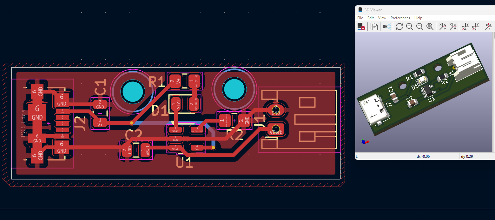
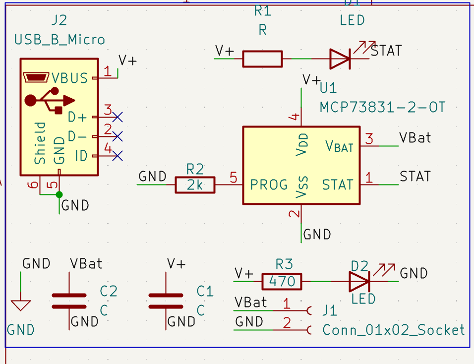

# Li-Ion Battery Charger PCB

A compact single-cell lithium-ion/lithium-polymer battery charger PCB designed in KiCad 9. The circuit is based on the Microchip MCP73831-2 charge-management controller and includes a Micro-USB power input, battery connector, and status indicators.

> **Project status:** Design only. This repository does not claim that the PCB has been fabricated, assembled, or tested. Verify the design against the exact component datasheets and perform appropriate electrical and thermal testing before practical use.

## Preview

### 3D PCB View


### Schematic


## Main Features

- MCP73831-2 single-cell Li-ion/Li-Po charge controller
- Micro-USB connector used as the 5 V input
- Two-pin battery connector
- Charge-status indicator driven by the controller's `STAT` output
- Additional power indicator LED
- Compact PCB layout designed in KiCad 9

## Key Components

| Reference | Component | Value / part |
|---|---|---|
| U1 | Battery charge controller | MCP73831-2-OT |
| J2 | Input connector | Micro-USB Type-B |
| J1 | Battery connector | 2-pin connector |
| R2 | Charge-current programming resistor | 2 kΩ |
| R1 | Status LED series resistor | Value must be confirmed in the schematic/BOM |
| R3 | Power LED series resistor | 470 Ω |
| C1, C2 | Capacitors | Values must be confirmed in the schematic/BOM |
| D1 | Charge-status LED | LED |
| D2 | Power indicator LED | LED |

The charge current is set by the programming resistor connected to `PROG`; confirm the intended current using the MCP73831-2 datasheet and the exact resistor value before use. Do not assume the board is suitable for every cell or battery pack.

## Connector Notes

### Micro-USB input (J2)
- `VBUS`: 5 V input
- `GND`: ground
- `D+`, `D-`, and `ID`: not used in this design
- Shield is connected to ground in the schematic

### Battery connector (J1)
- Pin 1: `VBat`
- Pin 2: `GND`

Check connector orientation and polarity against the PCB silkscreen before connecting a battery.

## Repository Structure

```text
Li-Ion-Battery-Charger-PCB/
├── KiCad/
│   ├── Li_Battery_Charger.kicad_pro
│   ├── Li_Battery_Charger.kicad_sch
│   └── Li_Battery_Charger.kicad_pcb
├── Images/
│   ├── li-ion-charger-3d-view.png
│   └── li-ion-charger-schematic.png
├── Documentation/
└── README.md
```

## Design and Safety Notes

- Intended for a **single-cell 4.2 V nominal-charge-voltage Li-ion/Li-Po battery**, consistent with the MCP73831-2 variant; verify the exact IC suffix and battery specification.
- Confirm the programmed charge current, USB source capability, resistor power ratings, capacitor values/ratings, PCB copper width, thermal dissipation, and component footprints before fabrication.
- This board is a charger circuit, not a complete battery-protection system. Use a cell with appropriate protection or add a suitable protection circuit as required by the application.
- The schematic currently leaves the capacitor values and R1 value unspecified; complete and verify the BOM before fabrication.
- Run KiCad ERC and DRC, review the generated reports, and test the assembled board with a current-limited supply and suitable battery test procedure before relying on it.
- No charging performance, thermal performance, or safety certification is claimed.

## Tools

- KiCad 9
- MCP73831-2 charge controller

## License

This project is released under the MIT License. See [LICENSE](LICENSE).
